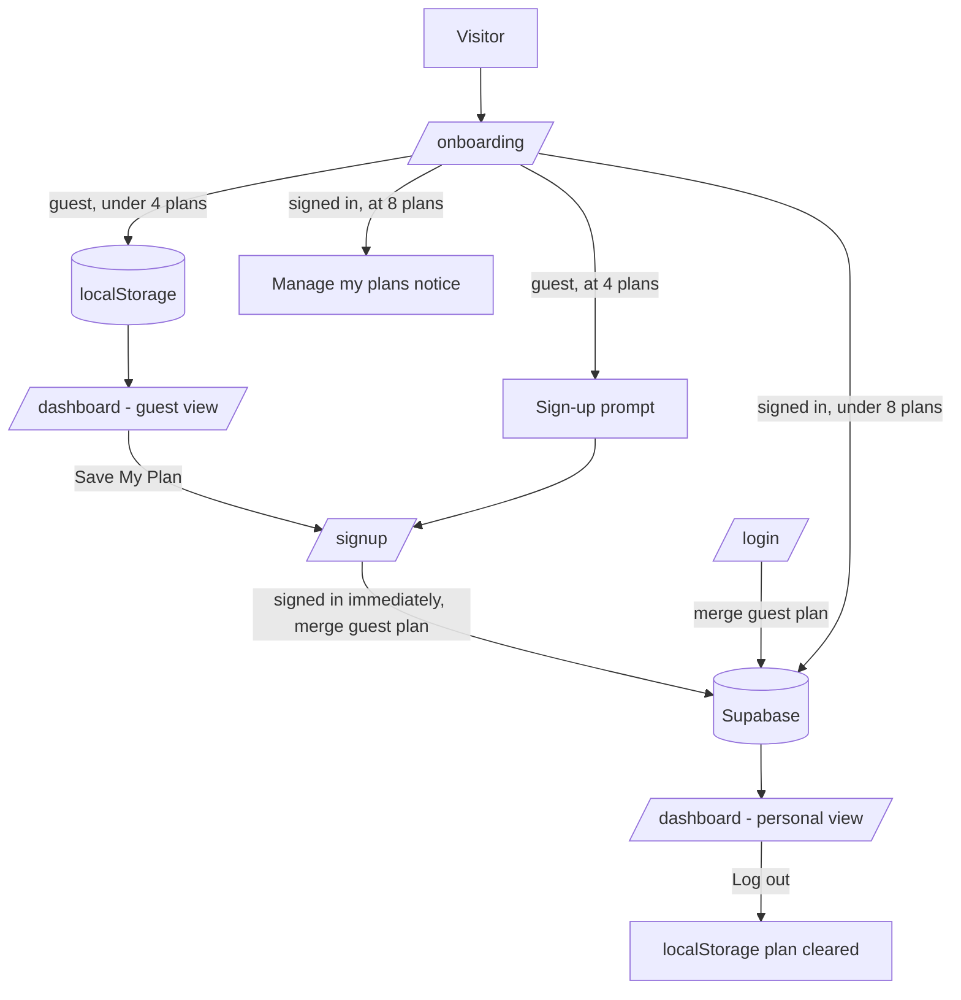

# Guest vs Signed-in Users

How My Caribbean Companion behaves for visitors who have not logged in (**guests**)
compared with users who have a free account (**signed in**): what each can do, where
their data lives, and how routing differs.

> Auth state comes from `useAuth()` in `components/auth/AuthProvider.tsx`.
> `user` is `null` for guests. While `loading` is true, pages avoid assuming either state.

---

## At a glance

| | Guest | Signed in |
|---|---|---|
| **Plans** | 1 plan at a time (the latest) | Up to **8** saved plans, switchable |
| **Plan creation limit** | **4** distinct plans per browser | 8 saved at once; deleting frees a slot |
| **Where data lives** | Browser `localStorage` only | Supabase (`profiles`, `plans`, `checklist_items`) |
| **Checklist progress** | This browser only | Synced across devices |
| **Profile** | None | Name, home country, current country, profession, date of birth |
| **Plan My Move pre-fill** | From last local plan | From profile, then last plan |
| **Dashboard** | Single-plan workspace | Profile header + "My plans" + workspace |
| **Delete data** | Clear site data in their browser (nothing is stored server-side) | "Delete account" on profile page |
| **AI Companion** (`/companion`) | Sign-in prompt | **5** messages per day (resets midnight UTC) |
| **Research tools** (jobs, housing, compare, cost, resources) | Full access | Full access |

---

## Feature-by-feature

### Plan My Move (`/onboarding`)

| | Guest | Signed in |
|---|---|---|
| Pre-fill | Last plan in `localStorage` | Profile home country + profession, then last plan |
| On "Generate My Plan" | Plan saved to `localStorage` | Plan saved to Supabase **and** `localStorage` (marked as synced) |
| Limit check | Browser counter (`mcc_guest_plans`) | Database trigger (`plans_enforce_limit`) |
| At the limit | "You've made 4 plans as a guest" → Create account / Log in | "You have 8 saved plans" → Manage my plans |
| Usage hint | "Guest plans used: X of 4" on step 3 | Shown in "My plans" on the dashboard |

Regenerating a route already made (same home country, destination and profession)
never counts against either limit.

### Dashboard (`/dashboard`)

| | Guest (`GuestDashboard`) | Signed in (`UserDashboard`) |
|---|---|---|
| No plan yet | Redirects to `/onboarding` | "You don't have a plan yet" card |
| Header | — | Profile header (name, facts, Edit profile) |
| Plan switcher | — | "My plans" cards with progress, "X of 8 plans", delete |
| Save prompts | `SavePlanBanner` + "Save My Plan" sidebar button | Hidden |
| Checklist ticks | `localStorage` | Supabase (optimistic update, reverted on error) |
| PDF export | Status: "Guest User" | Status: "Registered User" |
| Cost / Jobs / Housing tabs | Same | Same |

### Profile & account

| | Guest | Signed in |
|---|---|---|
| `/dashboard/profile` | Redirected to `/login` | Edit profile, Delete account |
| Navbar | "Sign up" / "Log in" | "Hi, {name}" (links to dashboard) + "Log out" |
| Delete account | n/a | Type `DELETE` → `DELETE /api/account` removes the user and all rows |

### Same for everyone

`/`, `/about`, `/contact`, `/csme-basics`, `/resources`, `/resources/[code]`, `/jobs`,
`/housing`, `/compare`, `/cost-estimate` and all `/api/*` data routes except `/api/chat`
behave identically. Pages that personalise (jobs, housing, compare, cost estimate,
AI companion) read the **current plan from `localStorage`** for both user types, so a
signed-in user's open plan is mirrored there when they select it on the dashboard.

---

## Routing

### Route access

| Route | Guest | Signed in | Enforced by |
|---|---|---|---|
| `/dashboard/profile` | → `/login?redirect=/dashboard/profile` | ✅ | `middleware.ts` + page check |
| `/community` | → `/login?redirect=/community` | ✅ (coming soon) | `middleware.ts` |
| `/dashboard` | ✅ guest view (→ `/onboarding` if no plan) | ✅ personal view | `app/dashboard/page.tsx` |
| `/reset-password` | Shows "Reset link expired" | ✅ choose new password | Page check (needs recovery session) |
| `DELETE /api/account` | `401` | ✅ deletes own account | Route checks session cookie |
| `/companion` | Sign-in card | ✅ chat (5 messages/day) | `app/companion/page.tsx` |
| `GET`/`POST /api/chat` | `401` | ✅ (`429` once today's 5 are used) | Route checks session cookie + `claim_chat_message()` |
| Everything else | ✅ | ✅ | — |

`/dashboard` is intentionally **not** protected by middleware so the guest flow can land there.

### Flows

### Signing up and logging in

1. **Sign up** (`/signup?redirect=…`) collects name, home country, date of birth and
   profession. With Supabase **Confirm email off** (current setting), the user is signed
   in immediately: the guest plan is merged and they go to `redirect` (default
   `/dashboard`). If Confirm email is turned back on, signup shows "Check your email"
   instead and no session exists until the email is confirmed.
2. **Log in** (`/login?redirect=…`, default `/dashboard`) calls `mergePlanToSupabase`,
   which copies the guest plan and checklist from `localStorage` into Supabase.
3. The dashboard runs the merge again on load (it is idempotent). If the account
   already has 8 plans, the guest plan is not saved and a notice explains why.

### Logging out

`signOut()` clears the Supabase session and the local plan + checklists
(`clearLocalData`), then does a full page load of `/`, so logging out (and deleting an
account) always lands on the **home page**, even from pages that would otherwise
redirect guests elsewhere. The guest plan counter is **kept**, so logging out does not
reset a guest's 4-plan allowance.

### Password reset (no session required to start)

`/forgot-password` → email link → `/auth/callback?next=/reset-password` (exchanges the
link for a short recovery session) → `/reset-password`. Expired links redirect to
`/forgot-password?error=link_expired`.

---

## Where the data lives

| Data | Guest | Signed in |
|---|---|---|
| Current plan | `localStorage.mcc_plan` | `plans` table; mirrored to `mcc_plan` with `syncedUserId` |
| Checklist | `localStorage.mcc_checklist_<planId>` | `checklist_items` table (also mirrored locally) |
| Guest plan counter | `localStorage.mcc_guest_plans` | — |
| Profile | — | `profiles` table (created by `handle_new_user` trigger at signup) |
| Preferences | `mcc_preferred_currency`, `mcc_cost_viewed` | Same (per browser) |

Guests never write to the database. All user tables use row-level security
(`auth.uid() = user_id`), and every user row is removed by `ON DELETE CASCADE` when the
account is deleted.

### Automatic cleanup (`pg_cron`, migration 005)

| Job | Schedule | Removes |
|---|---|---|
| `clean-api-cache` | Daily 03:00 UTC | Expired `api_cache` rows |
| `clean-unconfirmed-users` | Sundays 04:00 UTC | Signups unconfirmed after 7 days (+ their rows) |

---

## Limits

| Limit | Value | Defined in | Enforcement |
|---|---|---|---|
| Guest plans | 4 per browser | `GUEST_PLAN_LIMIT` in `lib/plan-limits.ts` | Soft: `localStorage` counter (resettable by clearing site data) |
| AI Companion messages | 5 per day per account (UTC) | `CHAT_DAILY_LIMIT` in `lib/chat-limits.ts` | Hard: `/api/chat` claims a message via `claim_chat_message()` (migration 007); failed AI calls are refunded |
| Account plans | 8 saved at once | `USER_PLAN_LIMIT` in `lib/plan-limits.ts` **and** `supabase/migrations/006_plan_limit.sql` | Hard: database trigger rejects a 9th insert |

When changing the account limit, update **both** places so the UI and database agree.

---

## Key files

| Concern | File |
|---|---|
| Auth state | `components/auth/AuthProvider.tsx` |
| Protected routes | `middleware.ts` |
| Guest vs user dashboard | `app/dashboard/page.tsx` |
| Plan creation + limits | `app/onboarding/page.tsx`, `components/wizard/PlanLimitNotice.tsx` |
| Limit constants | `lib/plan-limits.ts` |
| localStorage + guest merge | `lib/persistence.ts` |
| Supabase reads/writes | `lib/userData.ts` |
| Account deletion | `app/api/account/route.ts`, `components/dashboard/DeleteAccount.tsx` |
| Password reset | `app/forgot-password/`, `app/auth/callback/route.ts`, `app/reset-password/` |
